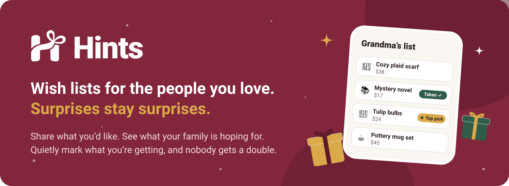
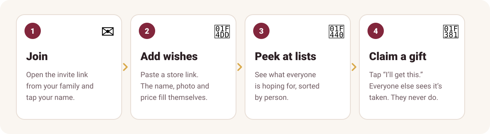
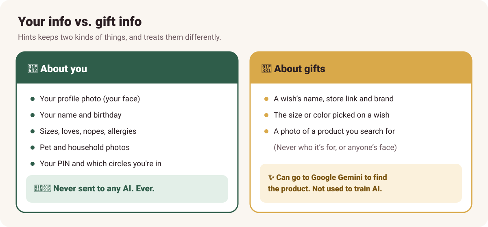
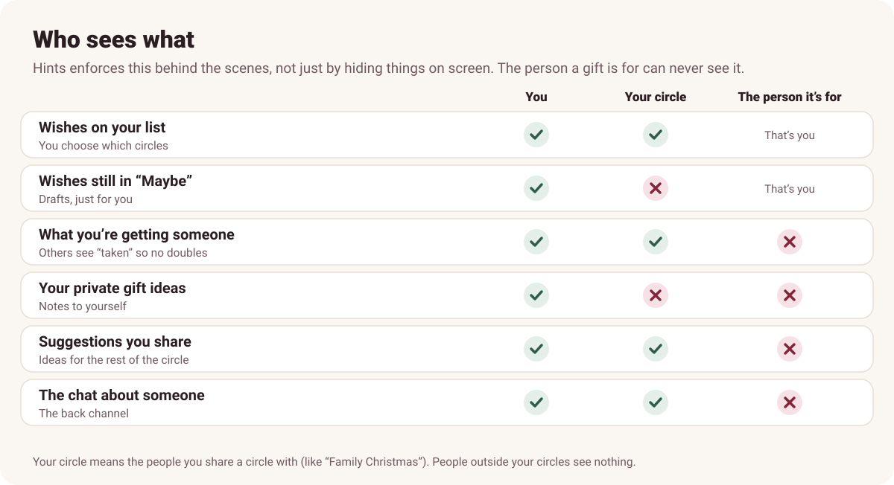

  

  <a href="https://hints.alexisdavidson.org"><b>👉 Open Hints</b></a>
  &nbsp;·&nbsp; <a href="#-get-it-on-your-phone">Put it on your phone</a>
  &nbsp;·&nbsp; <a href="#-your-privacy-in-plain-english">Your privacy</a>
  &nbsp;·&nbsp; <a href="#-questions">Questions</a>

---

## 🎄 What is Hints?

Hints is our family's wish list app. Everyone keeps a list of things they'd love, and everyone else can see it.

When you decide to buy something from someone's list, you tap **"I'll get this."** Everyone else sees it's taken, so nobody buys the same thing twice. **The person it's for never finds out.**

It's free, there are no ads, and nothing is for sale.

## ✨ How it works

  

A few more things you can do:

- ⭐ **Mark top picks** so people know what you want most.
- 🔗 **Link wishes that go together**, like a coloring book and pencils: both or neither, or "only with that one".
- 📝 **Keep private gift ideas** for someone. Only you can see them.
- 📰 **See what your people are up to** in the feed on the Circles tab: new wishes, profile updates, and posts. React, comment, or share a wish with a note ("this is SO you").
- 💬 **Chat about someone's gifts** ("Is she still a size M?"). Everyone in the circle can read it except that person.
- 🎂 **Get a heads up** before birthdays and Christmas, and when someone adds new wishes.
- 💰 **Track a budget** for each person, so you know what you've spent.
- 📸 **Snap a photo** of something in a store and Hints finds where to buy it.

## 📱 Get it on your phone

Hints works in your web browser, but it's nicer as an app on your home screen. It's free and takes about 20 seconds.

| iPhone or iPad | Android |
|---|---|
| 1. Open **[hints.alexisdavidson.org](https://hints.alexisdavidson.org)** in **Safari** | 1. Open **[hints.alexisdavidson.org](https://hints.alexisdavidson.org)** in **Chrome** |
| 2. Tap the **Share** button (the square with an arrow) | 2. Tap **Install** when it pops up (or the **⋮** menu, then **Install app**) |
| 3. Tap **Add to Home Screen**, then **Add** | 3. That's it! |
| 4. Open Hints from your home screen and sign in once more | |

> 💡 Hints walks you through this the first time you open it, so you don't have to remember any of it.

**Add wishes straight from a store app.** On Android, once Hints is installed it shows up when you tap **Share**. On iPhone, go to **Settings > Add from the Share button** in Hints to set up a one-tap "Add to Hints" shortcut.

---

## 🔒 Your privacy, in plain English

We know family gift lists are personal, and some of you have asked about photos and AI. Here's exactly what happens.

### Your face is never used for AI

  

Hints keeps two kinds of things, and treats them very differently.

**🙂 Things about you are never sent to any AI.**
Your profile photo, your name, your birthday, your sizes, your loves and nopes, your allergies, and photos of your pets or household stay inside Hints. They're only shown to people you share a circle with. Your profile photo (and cover photo, if you add one) is shrunk down and stored in Hints' own database, and that's it.

**🎁 Things about gifts can go to Google's AI (Gemini), only to find the product.**
Some helper features use Google Gemini, and a few of them run on their own in the background:

| Feature | What gets sent | What doesn't |
|---|---|---|
| **Paste or share a link** (fills in the name, photo and price, and keeps the price up to date) | The store link and the product's name | Who the wish is for, or anything about you |
| **Price guess** ("about $40" when a store doesn't show a price) | The wish's name, brand, store, and the size or color picked on it | Who the wish is for, or anything about you |
| **✨ Clean up a name** | The wish's name, link and brand | Who the wish is for, or anything about you |
| **📸 Photo search** | The photo you took of a product | Your profile photo, your name, who it's for |

Hints pays Google for this, and under Google's paid terms, **what we send isn't used to train their AI or improve their products.** Google only keeps it for a short time to catch abuse. Photo search photos aren't saved by Hints either.

> 💡 **Tip:** photo search is for products, so only snap the product, not people. And keep personal stuff out of a wish's name (put it in the notes instead, which are never sent).

### Who sees what

  

- **Surprises are protected for real.** Hints doesn't just hide things on the screen. It refuses to send them to the person a gift is for in the first place, so there's no way for them to peek.
- **Hide a wish from a circle.** In more than one circle (say, family and friends)? Each wish has a "Who can see this" switch.
- **The feed is not secret.** Posts and comments in the feed are seen by everyone in the circle, including the person they're about. It never shows who's getting what. For surprises, use the chat.
- **Phone notifications stay vague.** A chat notification just says "New message about Sam" unless you turn on message text. That way Sam can't read it over your shoulder on your lock screen.

### What Hints doesn't do

- ❌ No ads, and no selling or sharing your info with anyone.
- ❌ No tracking or analytics tools watching what you do.
- ❌ Not on Google or other search engines. Everything is behind your circle's sign-in. (If you make a share link for your list, anyone with that link can see your wishes, and search engines are told to skip it.)
- ❌ Hints never asks for your birth year, so your age is never shown.

### Good to know

- 🔢 **Everyone has a PIN.** Signing in is simple on purpose: tap your name and enter your 4-digit PIN. The PIN is what stops someone with your circle's invite link from signing in as you. Lost a phone? **Settings > Sign out everywhere else**.
- ☁️ **Where it's stored.** Hints runs on Cloudflare, a large internet company that millions of websites use. Their terms say they don't use what's stored there to train AI.
- 👩‍💻 **Who runs it.** Alexis built and runs Hints. Like the owner of any app, she can get to the database to fix things.
- 🛠️ **When something breaks.** If Hints hits an error, it tells Alexis what went wrong (the error message, which screen, and what kind of phone or browser), so she can fix it. Never what you typed, your wishes or anything private.
- 💾 **Backups.** Everything is backed up so a mistake can be undone. Weekly backups are encrypted before they're stored.
- 🗑️ **Want your info deleted?** **Settings > Delete my Hints** removes you and everything you added, for good. The same details are on the in-app [Privacy page](https://hints.alexisdavidson.org/privacy).

---

## ❓ Questions

**Will they know I bought it?**
No. The person a gift is for never sees who's getting what, or that anything is taken.

**Do I need a password or an email?**
No. You join from an invite link, tap your name, and pick a 4-digit PIN.

**Does it cost anything?**
No. It's free for everyone, with no ads.

**Can I use it on my computer?**
Yes. Go to **[hints.alexisdavidson.org](https://hints.alexisdavidson.org)** in any browser.

**Can I add gifts for someone who doesn't use the app, like a kid or a grandparent?**
Yes. In the Circles tab, tap "Add someone who doesn't use the app." You can keep their list for them.

**Something isn't working, or I have an idea.**
Tell Alexis! The easiest way is **Settings > Questions or problems** in Hints. It goes straight to her.

---

🛠️ Developers: the technical guide (setup, deploying, how everything works) is in [docs/DEVELOPERS.md](docs/DEVELOPERS.md).
